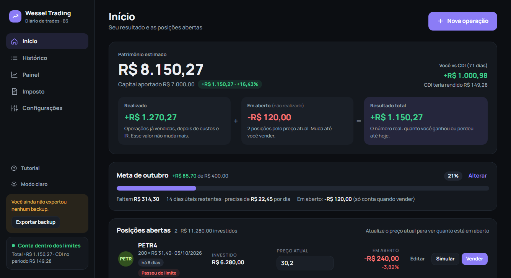
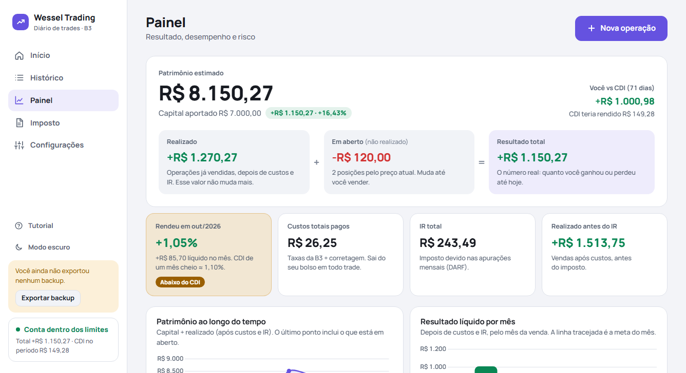

# Wessel Trading

Diário de trades para ações da B3. Registra compras e vendas, calcula custos e imposto de renda, acompanha o patrimônio e mostra se a estratégia está funcionando.

Roda inteiro no navegador, a partir de um único arquivo HTML. Não tem servidor, cadastro nem instalação, e os dados ficam só no computador de quem usa.

*As telas acima usam dados de exemplo.*

## Como usar

1. Coloque `Diario de Trades.html` e `chart.umd.min.js` na mesma pasta.
2. Abra o arquivo `Diario de Trades.html` em um navegador baseado em Chromium (Chrome, Edge, Opera, Opera GX, Brave).
3. Na primeira abertura, informe o capital inicial e as ações que você opera. Um tutorial guiado apresenta o resto.

Mantenha `chart.umd.min.js` na mesma pasta do HTML: é ele que desenha os gráficos sem depender de internet.

## Funcionalidades

**Operações**
- Registro de compras, com venda total ou parcial
- Classificação automática em day trade ou swing trade, pela data de compra e de venda
- Simulador de venda: informe a valorização (%) para ver o preço, ou o preço para ver a valorização, antes de comprar ou em uma posição aberta
- Histórico com filtros por mês, ação, tipo e situação

**Resultado**
- Patrimônio separado em realizado, em aberto e resultado total
- Comparação com o CDI no mesmo período
- Meta de lucro mensal, em reais ou em porcentagem do patrimônio
- Aportes e retiradas, sem distorcer o resultado

**Imposto de renda**
- Apuração mensal separada para day trade e swing trade
- Compensação de prejuízos, abatimento do IRRF e isenção das vendas até R$ 20 mil no mês
- Valor e vencimento da DARF, com marcação de DARF paga

**Análise e risco**
- Taxa de acerto, ganho e perda médios, payoff e acerto necessário para empatar
- Limite de perda por operação e limite de perda da conta, com alerta de "PARAR"
- Resultado por ação e por motivo de entrada
- Gráficos de patrimônio e de resultado por mês

**Sistema**
- Modo claro e modo escuro
- Backup manual (JSON) e exportação para planilha (CSV)
- Backup automático em um arquivo do computador
- Tutorial guiado, disponível a qualquer momento pelo botão **Tutorial**

## Seus dados

Tudo fica guardado no próprio navegador, neste computador. Nada é enviado para a internet.

Isso tem duas consequências:

- **Limpar os dados do navegador apaga o diário.** Ative o backup automático em **Configurações → Backup dos dados** ou exporte um backup com frequência.
- **Cada computador tem seus próprios dados.** Para levar o diário para outra máquina, exporte um backup em uma e importe na outra.

O backup automático só funciona em navegadores baseados em Chromium. O navegador pode pedir a permissão de gravação de novo a cada sessão.

## Limitações

Os valores de taxas e de imposto são estimativas, e o sistema não substitui um contador nem a apuração oficial. Em especial:

- O custo é calculado por lote comprado, não pelo preço médio da ação. Quem compra o mesmo papel várias vezes antes de vender pode ver diferença em relação ao cálculo oficial.
- O vencimento da DARF considera fins de semana, mas não feriados.
- Venda a descoberto não é suportada.
- As taxas da B3 e as alíquotas são configuráveis, e os valores padrão podem ficar desatualizados.

Este sistema não é recomendação de investimento.

## Estrutura

| Arquivo | Conteúdo |
| --- | --- |
| `Diario de Trades.html` | O sistema inteiro: marcação, estilos e código |
| `chart.umd.min.js` | Biblioteca [Chart.js](https://www.chartjs.org/) 4.4.1 (licença MIT), usada nos gráficos |
| `docs/` | Imagens deste README |

Não há etapa de build nem dependências para instalar. Para alterar o sistema, edite o HTML e recarregue a página.

## Direitos autorais

© 2026 Luiz Wessel. Todos os direitos reservados.

O código está aqui apenas para consulta. Não é permitido copiar, replicar, modificar, distribuir ou reutilizar este sistema, no todo ou em parte, sem autorização por escrito do autor. Os termos completos estão no arquivo [LICENSE](LICENSE).

A biblioteca Chart.js, incluída no repositório, pertence aos seus autores e segue a licença MIT.

## Créditos

Desenvolvido por Luiz Wessel.
